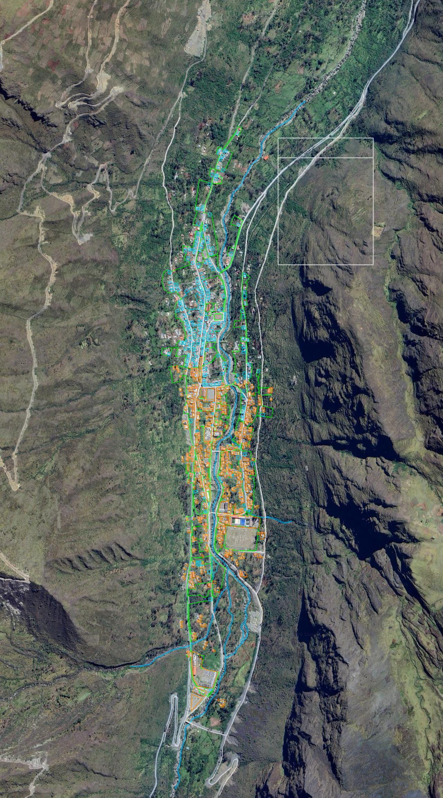
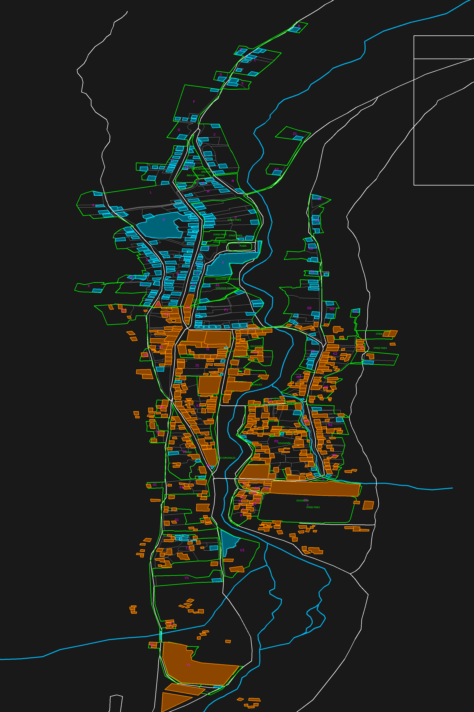
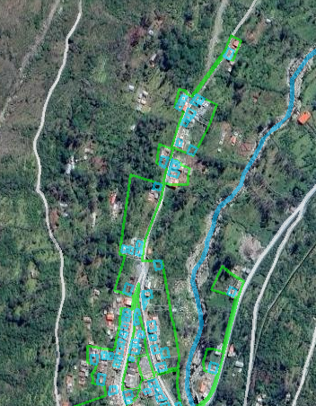
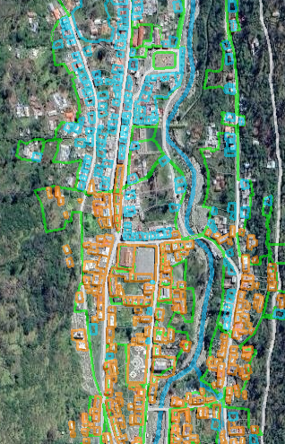
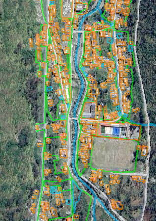
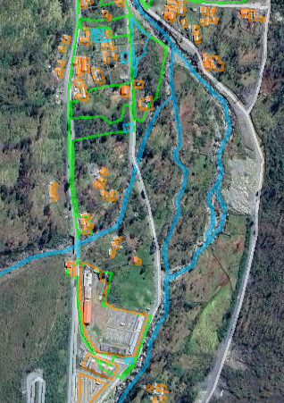

# 🗺️ Catastro Urbano Oficial de Limbani (Sandia - Puno, Perú)

-informational)

Levantamiento, vectorización y consolidación catastral del casco urbano del **Distrito de Limbani**, Provincia de Sandia, Departamento de Puno.  
Este repositorio integra el levantamiento oficial por lotes con la digitalización del avance de viviendas en **QGIS**, planos maestros en **AutoCAD DXF**, modelos 3D en **Google Earth KML** y el pipeline de automatización en Python.

---

## 📸 Control Visual y Superposición Satelital

### Vista General: Ortofoto Satelital + Catastro

### Vista CAD: Espacio Modelo (Estándar AutoCAD)

---

### Inspección Detallada por Sectores

| Sector Norte (Hidroeléctrica / Acceso) | Sector Centro (Plaza de Armas / Jr. Puno) |
| :---: | :---: |
|  |  |
| **Sector Confluencia (Estadio / Río Chinchalamani)** | **Sector Sur (Piscina Municipal / Salida)** |
|  |  |

---

## 📊 Metrados y Resumen Catastral

| Componente | Cantidad | Descripción |
| :--- | :---: | :--- |
| **Casas Digitalizadas (Avance)** | **482** | Huellas de vivienda digitalizadas, preservadas en su geometría original. |
| **Casas Complementadas** | **282** | Huellas habitacionales generadas con morfología andina (al frente de vía con patio). |
| **TOTAL VIVIENDAS CONSOLIDADAS** | **764** | Cobertura catastral 100% de los predios urbanos de Limbani. |
| **Lotes Prediales Oficiales** | **623** | Polígonos de propiedad cerrados basados en levantamiento oficial. |
| **Manzanas Registradas** | **87** | Rotulación oficial de manzanas (`A`, `B`, `C`... hasta periféricas). |
| **Red Hidrográfica** | **5 ejes** | Río Limbani (eje central), Río Chinchalamani (afluente) y quebradas. |
| **Equipamientos Urbanos** | **57** | Plaza de Armas, Estadio, Piscina, Parques, Educación y Salud. |

---

## 📂 Contenido del Repositorio

### 1. Sistema de Información Geográfica (`qgis/`)
- `Catastro-Limbani-Consolidado.qgz`: Proyecto completo para QGIS 3.x con simbología normalizada y ortofoto Google Satellite.
- `Catastro_Limbani_Oficial.gpkg`: GeoPackage maestro con capas: `Casas_Total`, `Lotes_Prediales`, `Rios_Cuencas` y `Calles`.
- `Catastro-Limbani.qgz` y `Catastro-Limbani.gpkg`: Archivos originales de avance (preservados intactos).

### 2. Planos CAD para Ingeniería (`catastro_limbani.dxf`)
Plano maestro compatible con AutoCAD (versión R2010), estructurado en 9 capas normalizadas:
- `01_RIOS_Y_CUENCAS` (Azul/Cian, 0.35 mm)
- `02_CALLES_Y_VIAS` (Blanco, 0.25 mm)
- `03_MANZANAS_ROTULOS` (Magenta, 0.35 mm)
- `04_LOTES_PREDIALES` (Blanco/Gris, 0.15 mm)
- `05_HUELLAS_CASAS_USUARIO` (Naranja, 0.30 mm)
- `06_HUELLAS_CASAS_COMPLEMENTO` (Cyan, 0.25 mm)
- `07_EQUIPAMIENTOS` (Verde, 0.40 mm)
- `08_TOPONIMIA_ROTULOS` (Blanco, nombres de calles y pasajes)
- `09_MEMBRETE_DATOS` (Membrete oficial con metrados y datos de ingeniería)

### 3. Modelo 3D para Google Earth (`catastro_limbani.kml`)
- Archivo KML con alturas y estilos temáticos por tipo de predio.

### 4. Herramientas y Pipeline Python (`tools/`)
- `generate_official_catastre.py`: Pipeline maestro de consolidación.
- `footprint_generator.py`: Algoritmo morfológico de huellas residenciales andinas.
- `create_consolidated_qgz.py`: Generador automático del proyecto QGIS.
- `export_official_kml.py`: Conversor UTM a Lat/Lon para Google Earth.
- `render_final_verification.py`: Motor OpenCV de control visual de alta resolución.
- `analyze_coverage.py`: Reporte de métricas catastrales.
- `push_to_github.py`: Sincronizador automatizado de GitHub.

### 5. Guía para Inteligencias Artificiales (`AGENT.md`)
- Manual técnico exhaustivo con directivas, reglas no negociables de topografía/hidrografía y especificaciones de código para futuros agentes de IA.

---

## 📌 Sistema de Coordenadas de Referencia (CRS)
- **Proyección:** Universal Transverse Mercator (UTM)
- **Zona:** 19 Sur
- **Datum:** WGS 84
- **EPSG:** 32719
- **Unidades:** Metros
